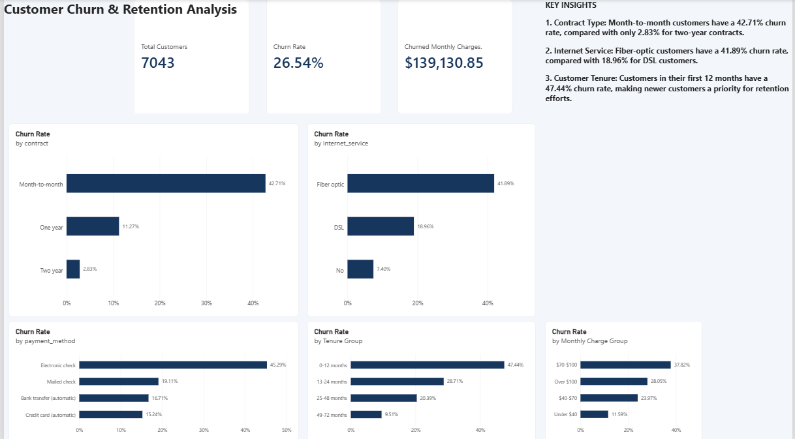
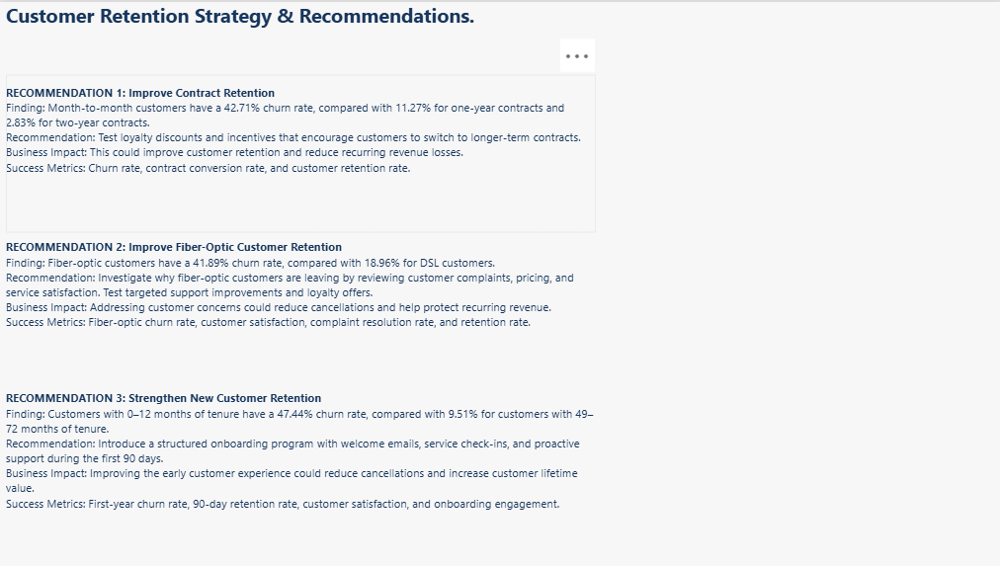

# Customer Churn Analysis

## Business Problem

Customer churn reduces recurring revenue and increases the cost of maintaining a stable customer base. The business needs a clear view of how much churn is occurring, which customer groups are most affected, and where retention efforts could have the greatest impact.

This project will use customer account, service, contract, billing, and tenure data to identify meaningful churn patterns and translate them into practical business recommendations.

## Business Objective

The objective is to evaluate customer churn from a business perspective, quantify its revenue impact, identify high-priority customer segments, and recommend actionable retention strategies. This is a descriptive and diagnostic business analysis project, not a machine learning project.

## Analysis Questions & KPIs

### Business Questions

1. What is the overall customer churn rate?
2. Which customer segments have the highest churn rates?
3. How does churn vary by contract type, tenure, internet service, payment method, and monthly charges?
4. Which factors are most associated with customer churn?
5. How much monthly recurring revenue is associated with customers who churned?
6. Which customer groups should the business prioritize for retention efforts?
7. What practical actions could reduce churn?

### Key Performance Indicators

- **Total customers:** Number of unique customers in the dataset.
- **Churned customers:** Number of customers whose churn status is `Yes`.
- **Churn rate:** Churned customers divided by total customers, expressed as a percentage.
- **Retained customers:** Number of customers whose churn status is `No`.
- **Retention rate:** Retained customers divided by total customers, expressed as a percentage.
- **Average monthly charges:** Mean monthly charge across customers.
- **Average tenure:** Mean number of months customers have remained with the business.
- **Monthly revenue at risk from churned customers:** Sum of monthly charges associated with customers who churned.

## Analysis Plan

1. Inspect the raw data and document its structure and quality.
2. Clean and prepare the data with Python and Pandas while preserving the original file.
3. Validate customer counts, churn labels, numeric fields, and missing values.
4. Load the prepared data into a SQL database.
5. Use SQL to calculate KPIs and compare churn across customer segments.
6. Evaluate the business and revenue impact of the observed churn patterns.
7. Build a Power BI dashboard that communicates the main findings.
8. Develop practical, evidence-based retention recommendations.

## Project Structure

- `data/` — raw and processed data files
- `src/` — Python scripts for cleaning, analysis, and database preparation
- `sql/` — SQL business analysis queries
- `powerbi/` — Power BI dashboard notes and files
- `screenshots/` — portfolio screenshots of the completed work

## Project Status

**Completed**

Successfully completed an end-to-end customer churn
analysis using Python, SQL, and Power BI.

Analyzed 7,043 customers, identified a 26.54% overall
churn rate, and developed a two-page interactive
Power BI dashboard.

Identified high-risk customer segments and presented
three data-driven business recommendations to improve
customer retention and reduce revenue losses.

## Power BI Dashboard Screenshots

### Customer Churn Overview

### Business Recommendations

